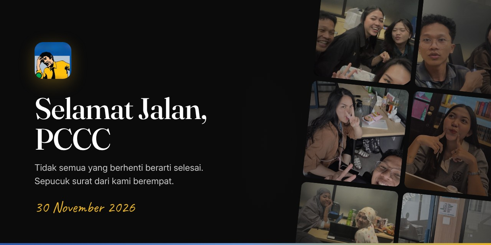
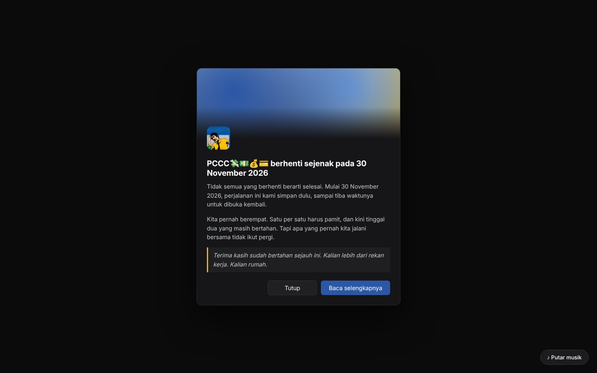
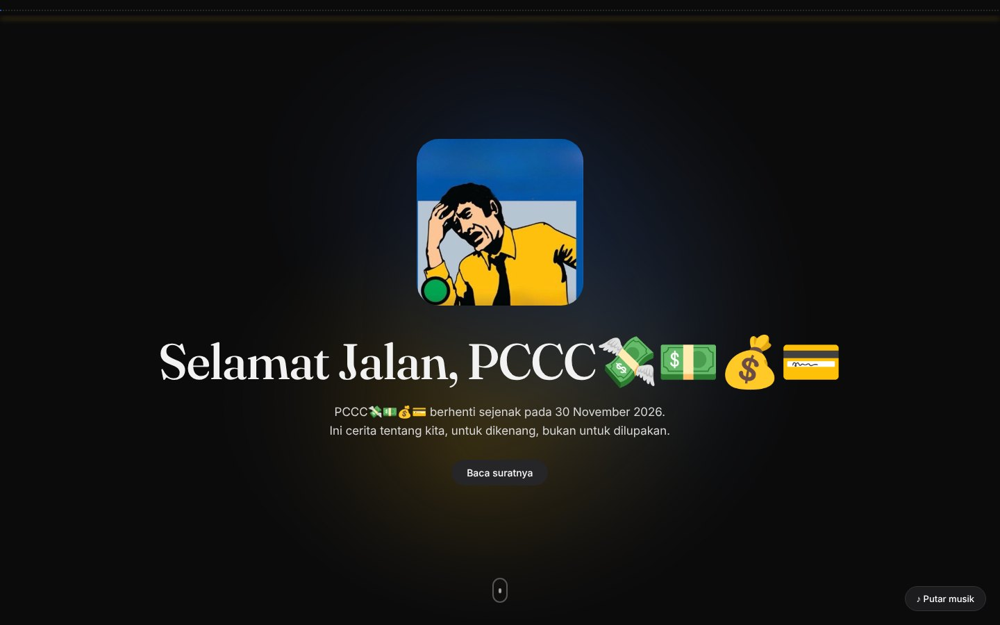
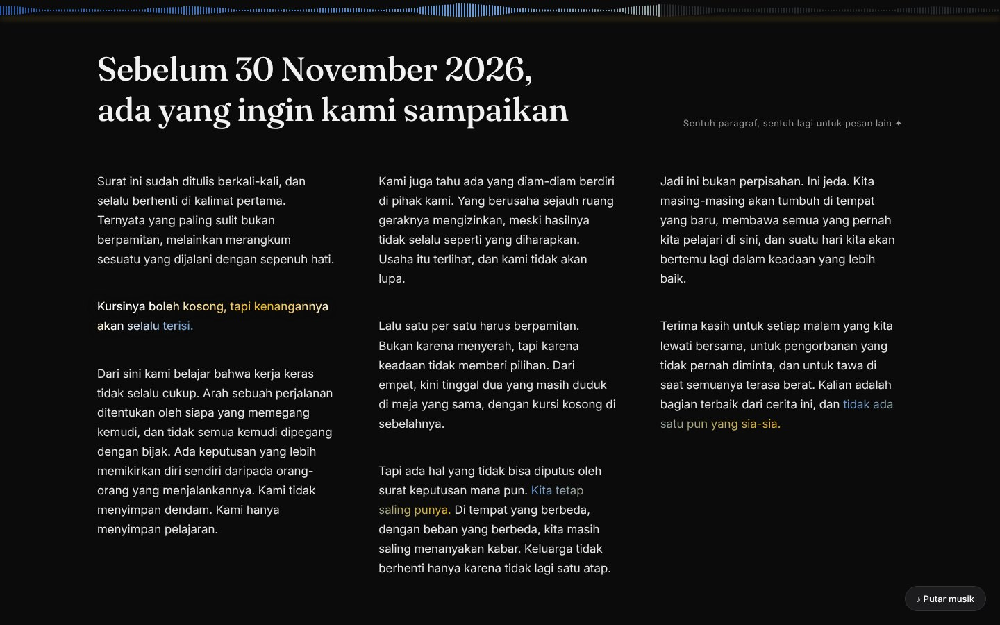
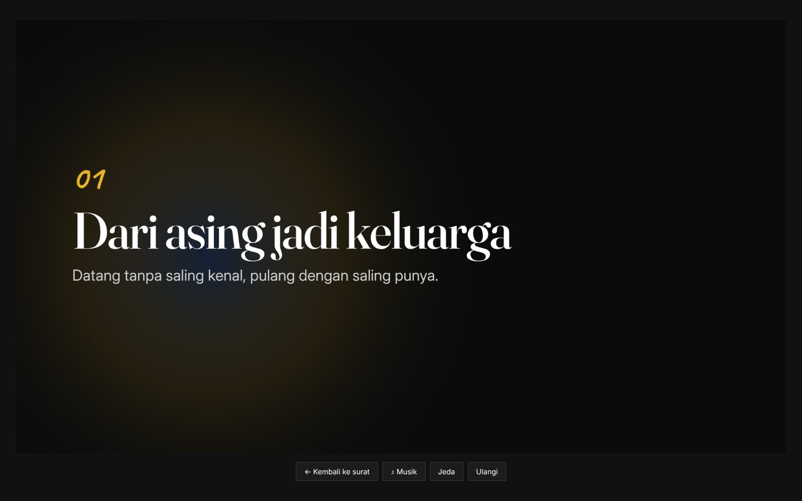

<div align="center">



# Selamat Jalan, PCCC

*Tidak semua yang berhenti berarti selesai.*

Sepucuk surat perpisahan interaktif dari kami berempat, untuk dikenang, bukan untuk dilupakan.

**[Buka surat](https://nullivy.github.io/pccc-farewell/)** &nbsp;·&nbsp; **[Putar reel](https://nullivy.github.io/pccc-farewell/reel.html)**

</div>

---

## Tentang

Proyek kecil ini dibuat untuk menandai berhentinya perjalanan tim PCCC pada **30 November 2026**. Bukan sekadar halaman pengumuman, tapi tempat untuk mengingat bahwa kami pernah berjuang bersama: lembur yang tidak terasa, makan seadanya di meja kerja, dan tawa di hari paling berat.

## Tampilan

<table>
  <tr>
    <td width="50%" align="center"><br><sub><b>Pengumuman</b></sub></td>
    <td width="50%" align="center"><br><sub><b>Pembuka</b></sub></td>
  </tr>
  <tr>
    <td width="50%" align="center"><br><sub><b>Surat</b></sub></td>
    <td width="50%" align="center"><br><sub><b>Reel kenangan</b></sub></td>
  </tr>
</table>

## Fitur

- **Pop-up pengumuman** yang terinspirasi dari pesan perpisahan Arc Browser.
- **Surat interaktif.** Sentuh sebuah paragraf, hurufnya terurai menjadi debu lalu berganti menjadi pesan penyemangat yang berkilau. Ada 30 pesan yang muncul secara acak.
- **Bar musik** di bagian atas yang bergerak saat lagu diputar sekaligus menjadi penanda posisi baca.
- **Reel kenangan** 16:9 berisi foto-foto tim, bisa dibuka tanpa memutus musik.
- **Ringan dan halus.** Semua animasi berjalan di 60 fps, dan otomatis dimatikan untuk pengguna yang memilih mengurangi gerakan.

## Struktur

```
pccc-farewell/
├── index.html        Pop-up, halaman pembuka, dan surat
├── reel.html         Reel kenangan
├── css/
│   ├── style.css
│   └── reel.css
├── js/
│   ├── main.js
│   └── reel.js
├── photos/           Foto untuk reel
├── assets/           Gambar preview dan screenshot
└── logo.png
```

## Editor reel

Buka [`reel.html?edit`](https://nullivy.github.io/pccc-farewell/reel.html?edit) untuk mengganti foto, mengubah teks, mengatur kecepatan, dan mengekspor reel sebagai video WebM.

## Kredit

- Musik: *Negoro Angin* oleh Muslih Fvnky, diputar melalui YouTube.
- Font: [Fraunces](https://fonts.google.com/specimen/Fraunces), [Inter](https://fonts.google.com/specimen/Inter), dan [Caveat](https://fonts.google.com/specimen/Caveat) dari Google Fonts.
- Dibuat dengan HTML, CSS, dan JavaScript murni, tanpa framework.

<div align="center">

---

<i>Dengan sepenuh hati,</i><br>
<b>Cece · Adek · Cak · Abang</b>

</div>
